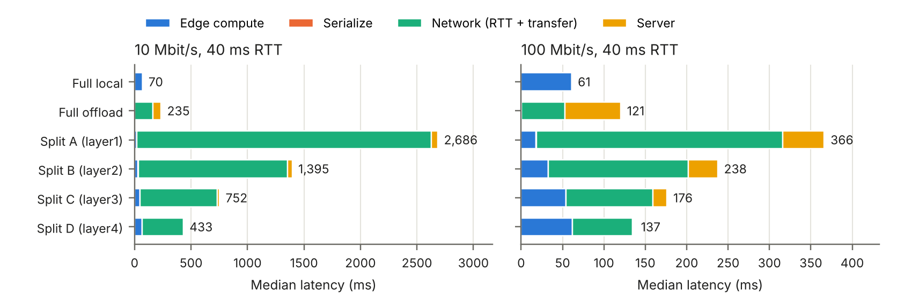

> **Status of the evidence.** All numbers in this checkpoint come from a **simulated, single-machine run**: edge client and inference server on one CPU-only host over loopback, with the network emulated in software. They are not yet measurements of the two-laptop testbed. Section 4 lists what this does and does not establish.

## 1. Current question and scope

**Question (unchanged from Proposal v2).** For which combinations of uplink bandwidth (1–100 Mbit/s) and round-trip time (5–150 ms) does offloading an intermediate activation give lower end-to-end latency than full on-device inference or full raw-frame offloading, and which split point is most efficient?

**Scope (unchanged).** One pretrained CNN backbone (torchvision ResNet-50, 224 × 224 input, no fine-tuning, no compression or distillation), point-to-point edge-to-server link, N = 200 measured requests per configuration, minimum viable matrix of 10 / 100 Mbit/s × 20 / 100 ms one-way delay (RTT 40 / 200 ms).

**Changes since Proposal v2** (proposed here for instructor approval):

| Change | Reason |
| --- | --- |
| Both laptops run **Windows**, not Linux. Link emulation uses (a) an application-level shaper (token-bucket rate + fixed one-way delay each way) by default and (b) the Windows built-in QoS rate limit for real TCP pacing. Linux `tc`/`netem` is kept as an optional path by booting the edge laptop from an Ubuntu live USB. | Hardware availability. Windows has no `tc`/`netem` equivalent. |
| Added a fourth split point after `layer4` (2048 × 7 × 7). | The three proposed splits all send more bytes than the raw frame (Section 3), so a later split is needed to locate where the payload falls below the raw frame. |
| Main finding framed as *uncompressed activations never win* rather than a split-favourable region. | Follows from the payload measurement; keeps the no-compression scope of Proposal v2 intact. |

## 2. Work completed since Proposal v2

- **Testbed implemented** ([github.com/KevinCKHo/split-computing-testbed](https://github.com/KevinCKHo/split-computing-testbed)), in Python/PyTorch, running natively on Windows and Linux:
    - model partitioner that cuts ResNet-50 after any stage; a unit test checks edge + server output equals the full model for every split point;
    - edge client and GPU inference server over TCP with a length-prefixed binary tensor format (no pickle), `TCP_NODELAY`, per-stage timing (host `perf_counter_ns`, CUDA events on the server);
    - three link-shaping back ends (app-level, Windows QoS, Linux `tc` htb + `netem`) driven from one config file and a matrix runner;
    - analysis pipeline that produces all three proposed deliverables (payload profile, crossover map, stage / tail-latency breakdown).
- **Full experiment matrix executed in simulation:** 6 configurations × 4 network profiles × (20 warm-up + 200 measured) requests = **4,800 measured requests**, all logged per request.
- **Setup documented** for both Windows laptops (static IPs on a direct Ethernet link, firewall rule, power plan), so the physical run needs only cabling and one command.

## 3. Preliminary results (simulated)

**Payload profile (Deliverable 1).** Bytes sent per request. Activations are lossless fp32; the raw frame is uint8.

| Configuration | Edge runs | Tensor sent | Bytes | vs. raw frame |
| --- | --- | --- | ---: | ---: |
| Full offload | nothing | 3 × 224 × 224 (uint8) | 150,528 | 1.0× |
| Split A, early | stem + layer1 | 256 × 56 × 56 | 3,211,264 | 21.3× |
| Split B, mid | through layer2 | 512 × 28 × 28 | 1,605,632 | 10.7× |
| Split C, late | through layer3 | 1024 × 14 × 14 | 802,816 | 5.3× |
| Split D, layer4 | through layer4 | 2048 × 7 × 7 | 401,408 | 2.7× |
| Full local | everything | nothing | 0 | – |

**End-to-end latency (median of 200 requests, ms).** Fastest per profile in bold.

| Configuration | 10 Mbit/s, 40 ms RTT | 10 Mbit/s, 200 ms RTT | 100 Mbit/s, 40 ms RTT | 100 Mbit/s, 200 ms RTT |
| --- | ---: | ---: | ---: | ---: |
| Full local | **69.9** | **58.1** | **61.2** | **55.9** |
| Full offload | 234.9 | 395.5 | 120.5 | 280.0 |
| Split A, early | 2,685.7 | 2,843.2 | 366.5 | 528.3 |
| Split B, mid | 1,395.4 | 1,558.1 | 237.8 | 398.2 |
| Split C, late | 752.2 | 918.5 | 176.4 | 335.0 |
| Split D, layer4 | 432.6 | 588.1 | 137.3 | 303.1 |

{width=88%}

**What it shows.**

1. Every lossless split sends 2.7–21× more bytes than the raw frame, so on a bandwidth-limited uplink a split can never beat raw offloading at equal server speed. Only the pooled 2048-float vector (8 KB) is smaller than the frame.
2. Network transfer dominates split latency: 97 % of split A's 2.7 s and 84 % of split D's 433 ms at 10 Mbit/s. Serialization is below 0.7 ms in every cell, so it is not a bottleneck.
3. Later splits are always faster (D < C < B < A), tracking payload size, and no split won any cell.
4. A simple additive model (edge + serialize + server + RTT + bytes × 8 / bandwidth), fitted from the measured medians, predicts the measured winner in 4 of 4 cells; it is used to draw the bandwidth × RTT crossover map (`fig2_crossover.png` in the repository).

**What it does not yet establish.**

- **Server speed.** The "server" here is a 2-thread CPU (~68 ms for full ResNet-50), not the RTX 4060. This penalises offloading. A what-if map with server time divided by 15 (an assumed GPU speed-up, not a measurement) shows raw offloading overtaking local inference only above ~25 Mbit/s and, at 100 Mbit/s, only below ~40 ms RTT; lossless splits still never win.
- **Real network behaviour.** App-level shaping paces bytes deterministically; it has no router queue, congestion-window growth or retransmission, so socket-buffer queuing and p99 tail effects (Deliverable 3) are not yet measured.
- **Edge hardware.** Edge compute was measured on a shared server CPU, not the Intel laptop. Full-local latency varies 56–70 ms across profiles although it does not use the network, which indicates contention noise from running two profiles in parallel.

## 4. Challenges, blockers and risks

| Item | Impact | Mitigation |
| --- | --- | --- |
| No `tc`/`netem` on Windows | Packet-level loss, jitter and queuing cannot be emulated natively | App-level shaper for the main matrix; Windows QoS for real TCP pacing; Ubuntu live USB on the edge for `netem` loss/jitter runs |
| Activations larger than the raw frame | The crossover map may show no split region | Reported as a finding; the added layer4 split and the pooled-vector size bound where a split could win |
| Two-laptop measurements not yet taken | Current evidence is simulated | Phase 1 run scheduled first (Section 5); scripts and setup are ready |
| Windows QoS throttling is driver- and edition-dependent | OS-level rate limit may be ignored | Verify every rate with `iperf3` before measuring; fall back to app-level or Ubuntu |
| Laptop noise (power states, background tasks) | Inflated tails | Best-performance power plan, AC power, warm-up, background apps closed |
| One-way delay vs. RTT | Ambiguity in reporting | Convention fixed: profile delay paid each way, RTT = 2 × delay, stated on every figure |

**Open question for feedback:** is the change to Windows hosts with app-level / QoS shaping acceptable, or should the final results use the Ubuntu-USB `netem` path throughout?

## 5. Remaining tasks and timeline

| Dates | Task | Exit criterion |
| --- | --- | --- |
| Nov 21–23 | Cable the laptops, static IPs, verify link with `iperf3`; Phase 1 baselines (full local, full offload) on real hardware | Both baselines logged, N = 200 |
| Nov 23 | Review checkpoint feedback; adjust scope | Plan updated |
| Nov 24–28 | Phase 2: full 2 × 2 matrix on the two laptops (app-level shaping), repeated with Windows QoS rate limit; packet captures (Wireshark/pktmon) at 10 Mbit/s; optional Ubuntu-USB `netem` runs with 0.1 % / 1 % loss | All 24 cells measured; traces saved |
| Nov 29 – Dec 1 | Phase 3: regenerate payload profile, crossover map from real data, stage and p99 analysis; compare to this simulation | Figures final |
| Dec 2 or Dec 7 | Final presentation | Slides delivered |
| Dec 8–14 | Final report | Submitted by Dec 14, 3:00 PM |

## 6. How proposal feedback was considered

> **[KEVIN: replace with the instructor feedback you received on Proposal v1/v2 and how this checkpoint responds to it, e.g. "Feedback asked for X; we did Y (Section N)."]**

Independently of instructor comments, the checkpoint follows Proposal v2's commitments: the minimum viable matrix is kept as proposed (2 bandwidths × 2 delays, three split regimes, two baselines, N = 200), the out-of-scope items (fine-tuning, lossy compression, distillation, multi-node topologies) remain excluded, and the scope was narrowed rather than expanded when the payload result appeared.

## 7. Team contributions

Individual project: all work by Chih-Kuan Ho.

## AI assistance

Substantial AI assistance (Anthropic's Claude) was used to write the testbed code, run the simulated experiment, produce the figures and draft this report. All design choices, results and text were reviewed by the author, who is responsible for the content.

## References

1. Hemminger, S. (2005). Network emulation with NetEm. *Proceedings of the Linux Kongress*, 18–24.
2. Kang, Y., Hauswald, J., Gao, C., Rovinski, A., Mudge, T., Mars, J., & Tang, L. (2017). Neurosurgeon: Collaborative intelligence between the cloud and mobile edge. *ACM SIGPLAN Notices*, 52(4), 615–629. https://doi.org/10.1145/3037697.3037698
3. Matsubara, Y., Levorato, M., & Restuccia, F. (2022). Split computing and early exiting for deep learning applications: Survey and research challenges. *ACM Computing Surveys*, 55(5), 90:1–30. https://doi.org/10.1145/3527155
4. Matsubara, Y., Yang, R., Levorato, M., & Mandt, S. (2023). SC2 benchmark: Supervised compression for split computing. *Transactions on Machine Learning Research*. https://doi.org/10.48550/arXiv.2203.08875
5. He, K., Zhang, X., Ren, S., & Sun, J. (2016). Deep residual learning for image recognition. *Proceedings of IEEE CVPR*, 770–778.
6. PyTorch and torchvision documentation (ResNet-50 pretrained weights, CUDA event timing). https://pytorch.org/docs/
7. Microsoft. New-NetQosPolicy (NetQos) documentation. https://learn.microsoft.com/powershell/module/netqos/new-netqospolicy
